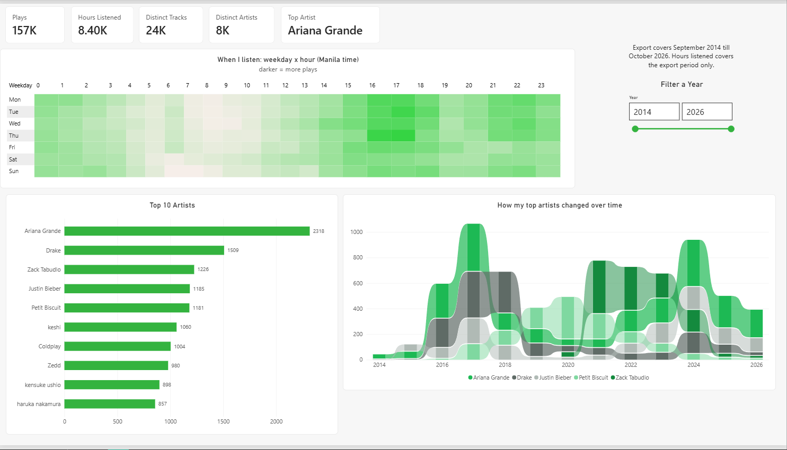
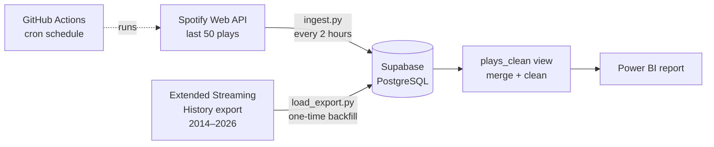

# Spotify Listening Analysis

An end-to-end data pipeline and Power BI report built on 12 years of my own Spotify listening history (September 2014 to today).

A Python job collects my recent plays from the Spotify Web API every two hours, stores them in a PostgreSQL database on Supabase, and merges them with Spotify's full Extended Streaming History export. A Power BI report on top of the cleaned data answers three questions:

1. **When do I listen most?**
2. **Which artists dominate my listening?**
3. **How has my taste shifted over time?**



---

## Key findings

**156,547 plays · 24K distinct tracks · 8K distinct artists · 8,400 hours listened**

### 1. When do I listen most?
- My peak listening hours are **4–6 pm** (hours 16 and 17 have about 12,000 plays each).
- The quietest time is **7–10 am**; 8 am has just 2,141 plays across 12 years.
- I'm a late-night listener: **midnight (8,126 plays) beats every morning hour**.
- Listening is driven by time of day, not day of week. Every weekday falls between 21,145 (Saturday) and 23,502 (Monday) plays.

### 2. Which artists dominate?
| Rank | Artist | Plays |
|---|---|---|
| 1 | Ariana Grande | 2,318 |
| 2 | Drake | 1,509 |
| 3 | Zack Tabudlo | 1,226 |
| 4 | Justin Bieber | 1,185 |
| 5 | Petit Biscuit | 1,181 |
| 6 | keshi | 1,060 |
| 7 | Coldplay | 1,004 |
| 8 | Zedd | 980 |
| 9 | kensuke ushio | 898 |
| 10 | haruka nakamura | 857 |

### 3. How has my taste shifted?
My listening moves in distinct eras:
- **2016–2018:** Ariana Grande and Drake dominate, peaking in 2017.
- **2019–2020:** Petit Biscuit takes over.
- **2021–2023:** Zack Tabudlo leads.
- **2024:** Ariana Grande returns as my top artist.

### Bonus finding: I skip a lot
Of 429,306 plays in the export, **275,011 (about 64%) lasted under 30 seconds**. Spotify doesn't count these as streams, so they are excluded from the analysis but kept in the raw table for future skip-rate analysis.

---

## Architecture



| Layer | Tool | Purpose |
|---|---|---|
| Ingest | Python, spotipy | Pulls recent plays from the Spotify API |
| Backfill | Python, psycopg2 | Loads 12 years of history from the export |
| Scheduling | GitHub Actions | Runs the ingest every 2 hours, no laptop needed |
| Storage | Supabase (PostgreSQL 17) | Raw tables plus a cleaned view |
| Transform | SQL view | Merges both sources, converts time zones, filters skips |
| Reporting | Power BI, DAX | Interactive dashboard |

### Why two data sources?
The Spotify API only returns your **last 50 plays** and has no endpoint for full history. The export has everything, but it's a one-time snapshot that takes weeks to arrive. Combining them gives complete history plus ongoing collection.

### Why every 2 hours?
Because the API only remembers 50 plays, anything older than that between runs is lost permanently. Every two hours keeps a comfortable margin even on heavy listening days.

---

## Data model

**`raw_plays`**: one row per play from the API. The full JSON response is stored in a `payload` column, so no data is lost if more fields are needed later.

**`raw_streaming_history`**: one row per play from the export, including `ms_played`, platform, shuffle and skip flags.

Both use `(played_at, track_uri)` as the primary key, so duplicate plays can't be inserted and every script is safe to rerun.

**`plays_clean`** (view): the single table Power BI reads from. It:
- uses the export for everything up to its last play, and the API only after that, so the overlap is never counted twice
- keeps only export plays of 30 seconds or more
- converts timestamps from UTC to Manila time (`Asia/Manila`)
- tags each row with its `source` (`export` or `api`)

The full schema is in [`sql/schema.sql`](sql/schema.sql).

---

## Data quality notes

| Issue | How it was handled |
|---|---|
| Timestamps are in UTC | Stored as UTC, converted to Manila time in the view |
| 2,390 duplicate rows in the export | Kept the longest play for each timestamp and track |
| 31 rows with no track ID (podcasts, audiobooks) | Dropped |
| Plays under 30 seconds (skips) | Excluded from analysis, kept in the raw table |
| Rapid skips logged as separate API plays | The API has no listening-time field, so API plays can't be filtered for skips |
| Gap from Oct 27–29, 2026 | Data between the export ending and scheduled collection starting is only partly captured |
| Hours listened | Calculated from `ms_played`, which only exists in the export |
| Partial years | 2014 starts in September; the current year is incomplete |

---

## Project structure

```
├── .github/workflows/ingest.yml   # scheduled job, every 2 hours
├── sql/schema.sql                 # tables and the plays_clean view
├── ingest.py                      # pulls recent plays from the Spotify API
├── load_export.py                 # one-time loader for the streaming history export
├── inspect_export.py              # checks the export before loading
├── test_spotify.py                # tests the Spotify login
├── test_db.py                     # tests the database connection
├── requirements.txt
├── .env.example                   # template for local credentials
└── .gitignore                     # keeps .env, tokens and personal data out of git
```

---

## Running it yourself

### 1. Prerequisites
- Python 3.10+
- A Spotify account (Spotify requires Premium for developer apps as of 2026)
- A free [Supabase](https://supabase.com) project
- Power BI Desktop

### 2. Spotify app
1. Create an app at the [Spotify Developer Dashboard](https://developer.spotify.com/dashboard).
2. Add the redirect URI `http://127.0.0.1:8888/callback` and select **Web API**.
3. Under **User management**, add your own Spotify account.

### 3. Local setup
```bash
git clone https://github.com/joseantoniobcortez-prog/spotifyanalysis.git
cd spotifyanalysis
python -m venv venv
venv\Scripts\activate          # Windows; use source venv/bin/activate on Mac/Linux
pip install -r requirements.txt
```

Copy `.env.example` to `.env` and fill in your Spotify credentials and Supabase **session pooler** connection string.

### 4. Database
Run [`sql/schema.sql`](sql/schema.sql) in the Supabase SQL Editor.

### 5. Test and ingest
```bash
python test_spotify.py   # opens a browser once to approve access
python test_db.py
python ingest.py
```

### 6. Backfill (optional)
Request your **Extended streaming history** from Spotify's privacy settings (it can take up to 30 days), unzip it into a `data/` folder, then run:
```bash
python inspect_export.py
python load_export.py
```

### 7. Schedule
Add these repository secrets under **Settings → Secrets and variables → Actions**:

| Secret | Value |
|---|---|
| `SPOTIPY_CLIENT_ID` | from the Spotify dashboard |
| `SPOTIPY_CLIENT_SECRET` | from the Spotify dashboard |
| `SPOTIPY_REDIRECT_URI` | `http://127.0.0.1:8888/callback` |
| `DATABASE_URL` | your Supabase connection string |
| `SPOTIFY_CACHE` | the full contents of your local `.cache` file |

The workflow then runs automatically every two hours. You can also trigger it manually from the **Actions** tab.

> GitHub disables scheduled workflows after 60 days with no repository activity, so commit occasionally to keep it running.

### 8. Power BI
Connect with **Get Data → PostgreSQL database** using your Supabase pooler host and database `postgres`, then load `plays_clean`. If you get a certificate error, download the SSL certificate from Supabase's database settings and install it into Windows' **Trusted Root Certification Authorities** store.

---

## What I learned

- **Designing around API limits.** The 50-play limit shaped the whole architecture: the schedule, the backfill, and how the two sources are merged.
- **Idempotent loading.** Primary keys plus `on conflict do nothing` make every script safe to rerun, which matters when a job runs unattended.
- **Keeping raw data raw.** Storing the full API response and every export row, then cleaning in a view, meant I could change the cleaning rules without reloading anything.
- **Secrets management.** Credentials live in `.env` locally and in GitHub Secrets for the scheduled job, and never in the code or the repo.
- **Checking data before trusting it.** Inspecting the export first surfaced the duplicates, the missing track IDs and the 64% skip rate before they could distort the analysis.

---

## Tech stack

Python · spotipy · psycopg2 · pandas · PostgreSQL · Supabase · GitHub Actions · Power BI · DAX
